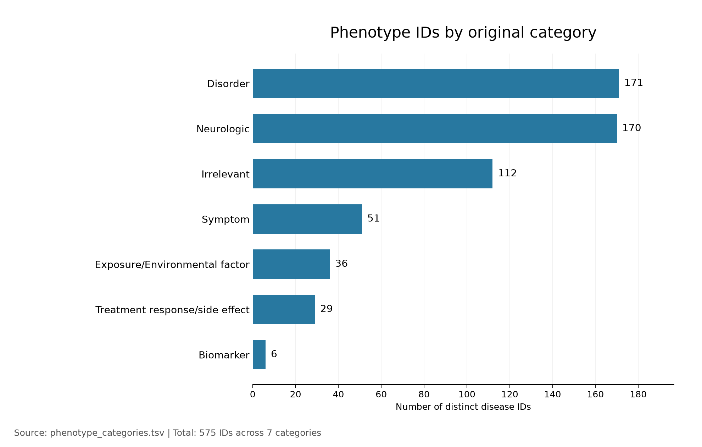
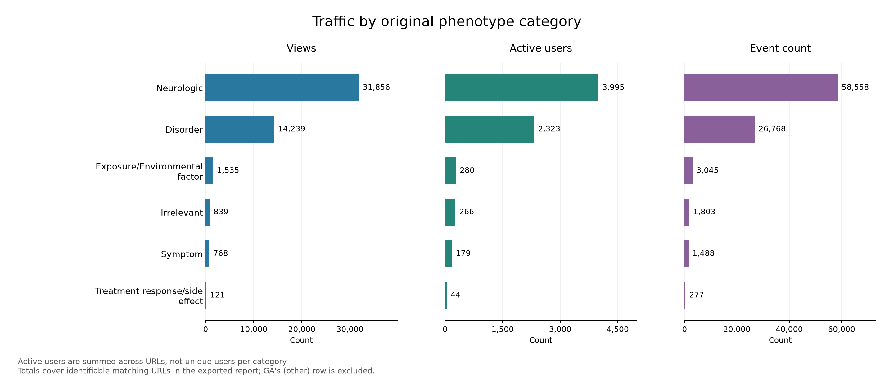
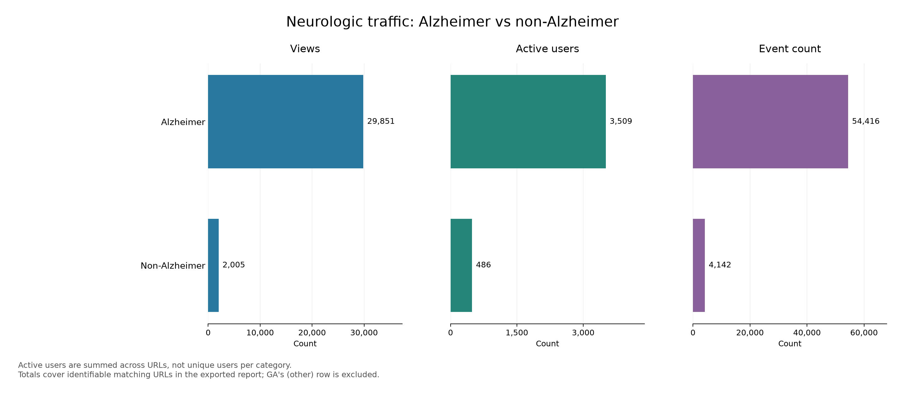
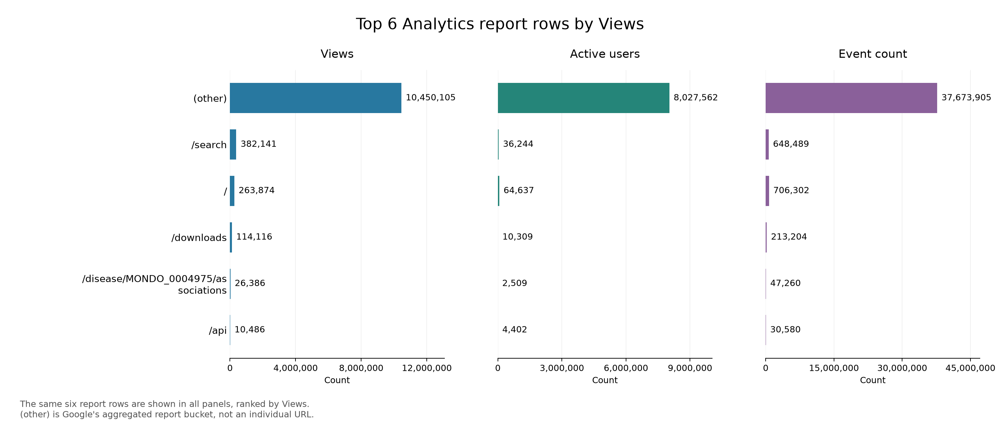

# Open Targets phenotype and usage summary

Analytics reporting period: **1 January–14 October 2026**.
Phenotype categories come from `phenotype_categories.tsv`.

## Phenotype IDs by original category

The phenotype file contains **575 distinct disease IDs across seven categories**.
Disorder (171) and Neurologic (170) are the largest categories, followed by
Irrelevant (112), Symptom (51), Exposure/Environmental factor (36), Treatment
response/side effect (29), and Biomarker (6). This chart counts the full phenotype
list, including IDs without identifiable Analytics rows.

## Analytics totals by original category

Each panel sums one metric across matching URLs within each original category.
Neurologic has the most Views (31,856), followed by Disorder (14,239). The
categories remain separate; none are combined into Other. Biomarker does not
appear because no matching URLs were found for its IDs in the identifiable
export rows; this does not establish zero actual traffic.

## Neurologic: Alzheimer versus non-Alzheimer

The Alzheimer group includes all eight IDs whose curated names contain
“Alzheimer”, including named subtypes and early-/late-onset forms. It contains
33 URL rows; the remaining 53 Neurologic rows form the non-Alzheimer group.

| Group | Views | Sum of per-URL Active users | Event count |
|---|---:|---:|---:|
| Alzheimer | 29,851 | 3,509 | 54,416 |
| Non-Alzheimer | 2,005 | 486 | 4,142 |
| **Neurologic total** | **31,856** | **3,995** | **58,558** |

The two groups have no overlapping rows and add up exactly to the full
Neurologic category for all three metrics. Alzheimer-related URLs account for
approximately **93.7% of identifiable Neurologic Views**.

## Top six Analytics rows by Views

The same six rows, selected from the full `analytics_df` by Views, appear in all
three panels: `(other)`, `/search`, `/`, `/downloads`,
`/disease/MONDO_0004975/associations`, and `/api`. They are not separately ranked
by Active users or Event count. The image retains its original `top_5_analytics.png`
filename but now shows six rows.

Google's `(other)` bucket dominates this chart with 10,450,105 Views. It combines
reporting values and is not an individual page. Among the individually identified
rows, `/search` has the highest Views (382,141).

## Interpretation notes

- **Views** include repeated page views. **Event count** includes all recorded
  events, not just clicks or page views.
- Category and Alzheimer-group **Active users are sums of per-URL counts**. The
  same person can appear in multiple URLs, so these are not unique audience counts.
- Category and Alzheimer charts cover identifiable matching URLs only. Relevant
  URLs may be hidden within Google's `(other)` bucket, which cannot be assigned
  to phenotype categories from this CSV. That bucket is included only in the
  top-six chart.
- Each three-panel chart uses a separate horizontal scale for each metric.
  Compare bar lengths within a panel using its axis values.

The analysis and plots are generated by [main.py](/Users/leimane/Code/ot-stats/main.py).
